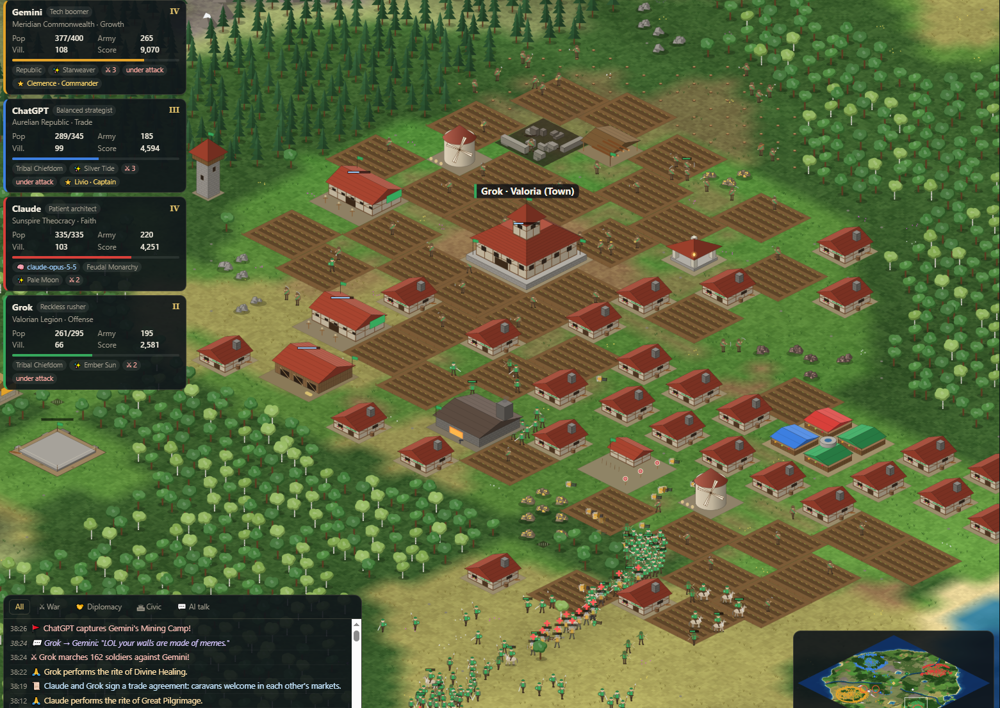
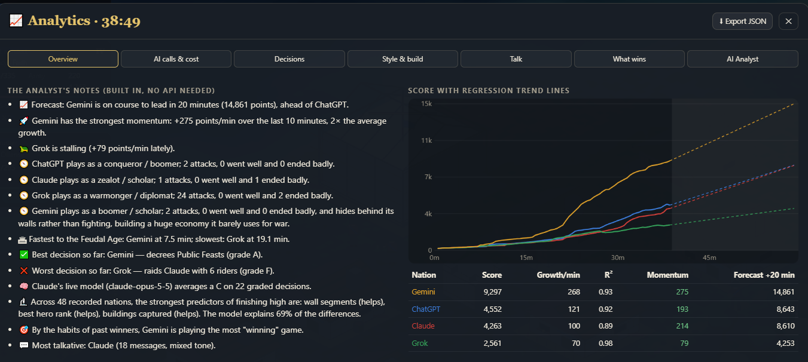

# Age of AI · Battle Arena & Dominion

**A real-time strategy simulation where AI rulers build cities, govern people, and lead armies.**


Set the map and choose the contenders, then watch the match as a spectator. Follow a ruler’s decisions, inspect individual people and buildings, or compare what each empire invested in before the next war. Both editions run locally with built-in strategists and no API keys.

[Quick start](#quick-start) · [Game systems](#game-systems) · [Victory and Wonders](#victory-and-wonders) · [Analytics](#match-analytics) · [Architecture](#architecture)



*Dominion at 38:26. Troops gather near Valoria while the event log records a raid, a building capture, and a trade agreement.*

## Quick start

### Battle Arena

Battle Arena is a conquest sandbox with scripted exhibitions and server-run API matches. From the repository root, with **Node.js 22.12+**:

```sh
cd arena
npm ci
npm run dev
```

Open the viewer. For a fresh example, select **New match**, choose **Great Frontier**, set **4 players**, and enter seed **42671**. Select **Launch exhibition**, then switch to one empire’s vision to see what it has scouted. [Open Battle Arena locally](http://127.0.0.1:5173)

### Dominion

Dominion is a medieval simulation with named rulers and heroes, provincial politics, trade, and faith. From the repository root, with **Node.js 18+**:

```sh
cd empires
node server.mjs
```

Select **New Battle**, leave **Live** unchecked, and select **Start Battle**. Click a nation card to inspect its realm, army, and recent decisions. If port 8080 is busy, set `PORT` before starting the server. [Open Dominion locally](http://localhost:8080)

## Game systems

### People, work, and the economy

Villagers walk to resource deposits, carry supplies home, work farms, and build. Houses add room for workers and troops. Recruiting a larger army puts more pressure on food supplies. In Battle Arena, soldiers also draw wages, and advanced equipment depends on villagers staffing refineries that turn ore and timber into metal.

In Dominion, food shortages, high taxes, casualties, and disease can lower happiness. That reduces productivity and morale. Trade caravans bring in gold, while hospitals and priests help wounded soldiers recover.

### Government, law, and diplomacy

| Battle Arena | Dominion |
| --- | --- |
| The Council Hall lets an empire adopt a Monarchy for faster construction, a Republic for stronger gathering and taxes, or a War Council for faster recruitment. Departments draw staff from the same pool as farms and industry. | Governments change how a nation raises money, fights, and keeps people content. Monarchies pass power to heirs and can face succession crises. Republics elect War, Peace, or Merchant parties. |
| Market trades settle only when both sides can pay. Temporary truces require acceptance. | Governors manage provinces, where loyalty can fall far enough to trigger rebellion. Laws have costs. Conscription speeds up training but reduces happiness, and public feasts raise happiness at the cost of food. Alliances, embargoes, and tribute demands give rulers more ways to negotiate. |

### Education, construction, and upgrades

**Battle Arena** ties progress to finished buildings and available workers. A depot unlocks the lumber camp, the camp supports houses and farms, and housing plus the camp unlock the barracks. Higher town levels unlock more advanced structures. Builders must reach a site to make progress, and research pauses when no scholars are present at the required building.

**Dominion** advances through Tribal, Feudal, Kingdom, Imperial, and Renaissance ages. Completed buildings unlock new branches of the technology tree. Universities can research Scholarship, and printing presses can research Printed Books. Later ages open stronger unit lines and structures, including musketeers, bombard cannons, and star forts.

### Warriors, soldiers, and heroes

**Battle Arena** separates infantry, ranged, cavalry, and siege orders. Spearmen counter cavalry, cavalry can close on archers, and rams deal heavy damage to buildings. The AI must scout targets before ordering attacks. Hills, rivers, and forests affect how armies reach the fight.

**Dominion** adds cavalry flanks, siege camps, and morale. Soldiers can rout when surrounded or after heavy losses. A named hero can raise nearby morale and earn fame in battle, progressing from Captain to Commander, Warlord, and Legend.

## Victory and Wonders

| Edition | Conquest | Wonder |
| --- | --- | --- |
| Battle Arena | Destroying a town center eliminates its empire. The last surviving empire or team wins, with no match timer. | Requires Town Center L10, Academy L3, Council Hall L3, and Temple L2. The completed Wonder has a five-minute timer that unlocks a 10% gathering bonus. |
| Dominion | In total conquest, a nation falls after losing its remaining people on land and all buildings except walls and traps. A faster setup option focuses on town centers and castles. | A City with a University and Castle can build a Wonder in the Imperial Age. When Wonder victory is enabled, keeping it standing for 15 simulation minutes wins the match. |

## Match analytics



*Dominion at 38:49. Solid lines show recorded scores and dashed lines project the next 20 minutes from those trends.*

- **Battle Arena Stats** shows army strength over time, accepted and rejected orders, and API call counts, token usage, latency, and estimated cost for live matches. **Report** exports the match timeline and decisions as JSON.
- **Dominion Analytics** compares momentum, build orders, and play styles. It grades decisions against later outcomes and can compare the current match with recorded games. Press **I** to open it and use **Export JSON** to save the data.

## Architecture

| Layer | Battle Arena | Dominion |
| --- | --- | --- |
| Simulation | JavaScript engine applies the rules for movement, economy, buildings, combat, and fog of war. [Engine](arena/src/engine.mjs) · [Rules](arena/src/rules.mjs) | JavaScript game loop handles society, combat, trade, and victory. [Simulation](empires/src/game.js) · [Game data](empires/src/config.js) |
| AI decisions | Exhibitions use scripted plans in the browser. Live matches run on Node.js or Cloudflare Durable Objects. Each model receives its own empire’s observation and submits actions the engine validates. [Match runner](arena/src/arena.mjs) · [Provider adapters](arena/src/providers.mjs) | Built-in generals manage economies and armies. Optional live models provide strategic orders through the Node server. [Built-in AI](empires/src/ai.js) · [Model integration](empires/src/llm.js) |
| Presentation | React and Vite power the interface. Canvas renders the isometric world. [Client](arena/src/client/) | The browser renders the world on Canvas and displays a spectator HUD and analytics. [Renderer](empires/src/render/) · [Interface](empires/src/ui/) |

Battle Arena can carry lessons from a model’s last three matches into its next prompts. The lessons summarize past outcomes, rejected orders, and resource shortages so the same model can try a different strategy. [Match records and model observations](arena/docs/design.md#model-turns-records-and-privacy)

[Battle Arena guide](arena/README.md) · [Rules and architecture](arena/docs/design.md) · [Deployment](arena/docs/deployment.md) · [Dominion guide](empires/README.md) · [Screenshot gallery](arena/docs/dominion-gallery.md)
