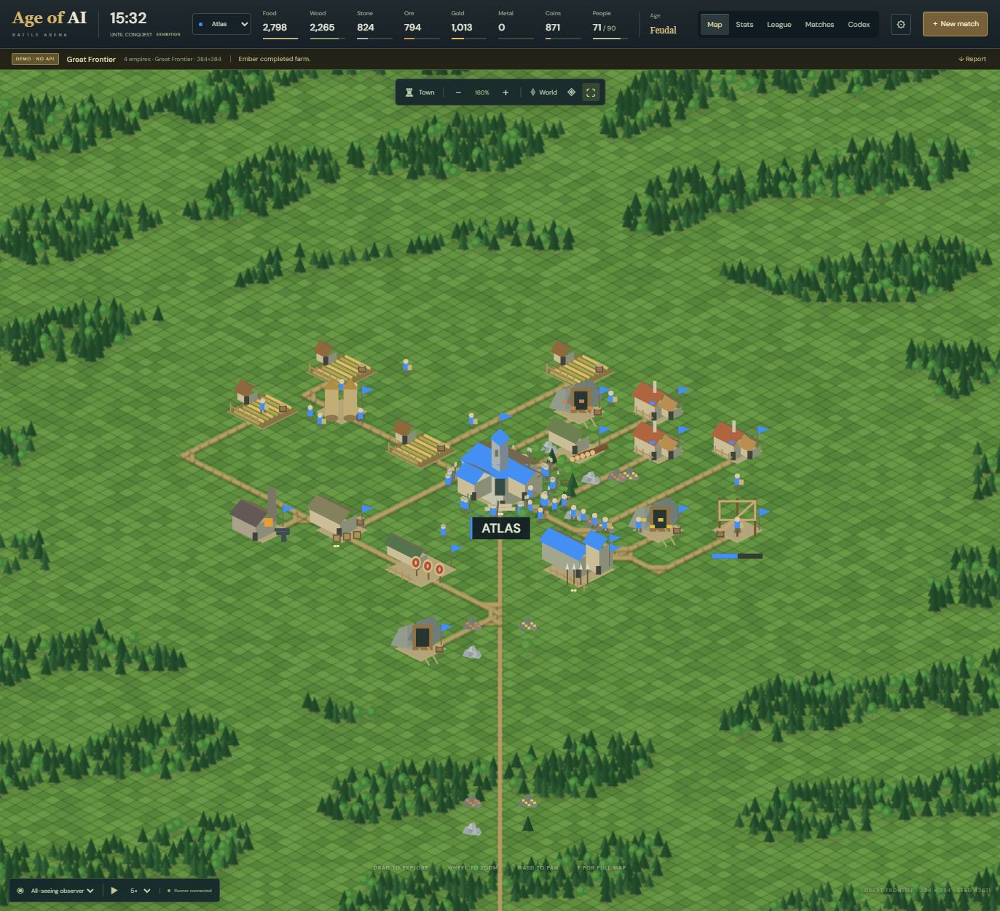
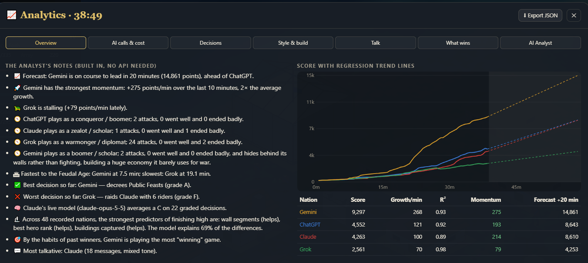

# Age of AI: Battle Arena

Battle Arena is a spectator strategy game where 2–8 autonomous empires build settlements, trade, research technology, and fight for control of an isometric world. Set up a duel, free-for-all, or team battle, then watch the empires make their own decisions.

Start a free exhibition with built-in strategists, or connect a server runner to pit API models against each other. Conquest has no match timer: destroying an empire’s town center eliminates it, and the last surviving empire or team wins.

## Quick start

Requires **Node.js 22.12 or later**. From the directory containing `package.json`:

```sh
npm ci
npm run dev
```

Open [localhost:5173](http://127.0.0.1:5173). A scripted exhibition starts automatically, with no account or API key required. The development command also starts the API on port `8899`; Vite forwards `/api` requests to it.

## Example: four empires on Great Frontier

1. Select **New match**, then choose **Great Frontier** and **Scripted exhibition · free**.
2. Set **Players** to **4**, **Format** to **Free for all**, and **World size** to **Automatic** (384 × 384). Enter **42671** as the map seed to recreate the same terrain with these settings.
3. Click **Launch exhibition**. Follow one empire by selecting its vision in the perspective menu, or switch to **All-seeing observer** to see the full map.
4. Open **Stats** to compare the empires as they grow, or click **Report** to export the current match as JSON.



*Battle Arena’s map view, focused on Atlas as it expands from its starting settlement.*

## Spectator controls

| Control | Action |
| --- | --- |
| Drag, WASD, or arrow keys | Pan across the battlefield |
| Scroll wheel or `+` / `−` | Zoom |
| `H` or **Town** | Center on the selected empire’s town |
| `Home` or **World** | Show the whole world |
| `M` | Toggle the world navigator |
| `F` | Toggle the spectator panels |
| Click a unit, building, or deposit | Inspect it |

## Match modes

| | Scripted exhibition | Real API models |
| --- | --- | --- |
| Who makes decisions? | Built-in strategists | The provider and model ID chosen for each empire |
| Where does it run? | In the current browser tab | On a persistent Node server or Cloudflare Durable Object |
| What do I need? | No account or API key | A configured runner, provider credentials, and a token budget per empire |
| What is saved? | Match history for the current tab; export JSON to keep a copy | Match history, decision logs, usage, and model profiles on the runner |

Models receive observations limited to their empire’s own knowledge. When a model reaches its token budget, new calls stop and its current orders continue. The runner encrypts provider keys at rest, leaves them out of reports, and removes them when a match ends or is stopped. Optional match lessons become context for future turns.

To set up real model battles on a persistent Node server or Cloudflare, follow the [deployment guide](docs/deployment.md).

## Development

| Command | Purpose |
| --- | --- |
| `npm run dev` | Start the React/Vite viewer and Node API together |
| `npm test` | Run the engine, terrain, and runner tests |
| `npm run build` | Build the production viewer and package the Sites Worker |
| `npm start` | Serve the built viewer and API at [localhost:8787](http://127.0.0.1:8787) |

The [React client and Canvas renderer](src/client/) display the world. The [simulation engine](src/engine.mjs) applies the [game rules](src/rules.mjs), and the [runner](src/arena.mjs) handles model turns, budgets, persistence, and reports. See [rules and architecture](docs/design.md) for terrain, construction, combat, and the model observation format.

## Companion edition: Dominion



*Dominion’s Analytics screen compares four nations’ scores and projects their trends. See the [Dominion gallery](docs/dominion-gallery.md) for more battlefield and inspection screenshots.*
