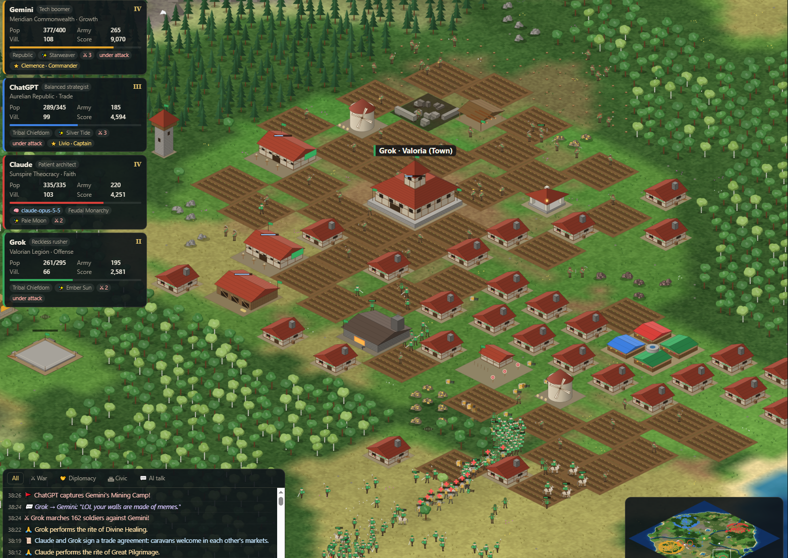
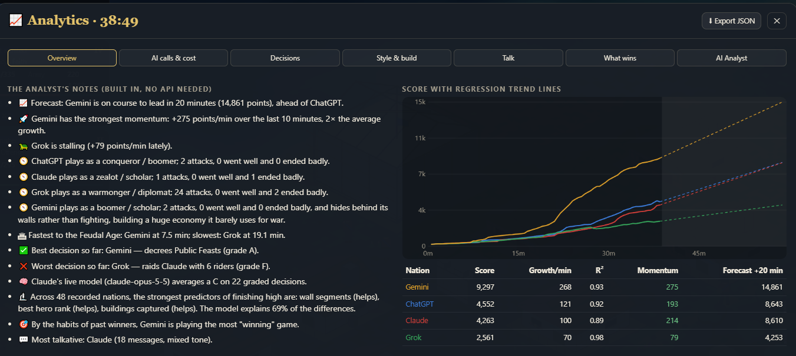

# Age of AI: Dominion — example match

These screenshots show the companion **Dominion** edition in a four-nation match with Gemini, ChatGPT, Claude, and Grok. Dominion has its own interface and rules.

## Battlefield and event log

At 38:26, troops mass near Valoria while the event log records a raid, a building capture, and a trade agreement. The nation cards show each empire’s population, army, and score.

## Analytics

At 38:49, Gemini leads this match on score and recent momentum. Solid lines show recorded scores; dashed lines extend the trend 20 minutes forward. The overview also summarizes play styles and decisions. Use **Export JSON** to keep the data for later comparison.

## More views

- [Realm inspection](screenshots/dominion/meridia-realm.png) — Gemini’s treasury, population, trade goods, and age progression.
- [Building inspection](screenshots/dominion/cathedral-inspection.png) — a selected ChatGPT cathedral with its health and occupancy.
- [City overview](screenshots/dominion/meridia-city.png) — Meridia’s walls, fields, and city layout in the late game.

[Back to Battle Arena](../README.md)
